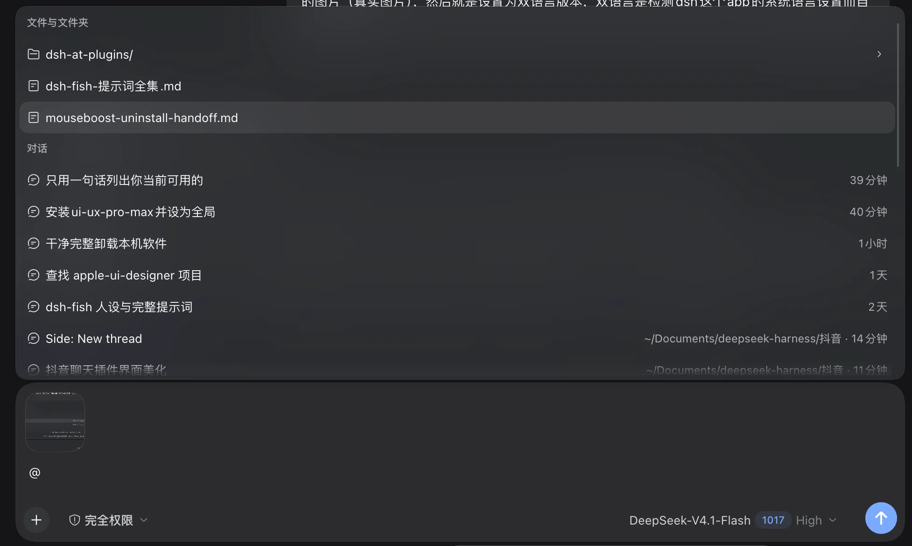
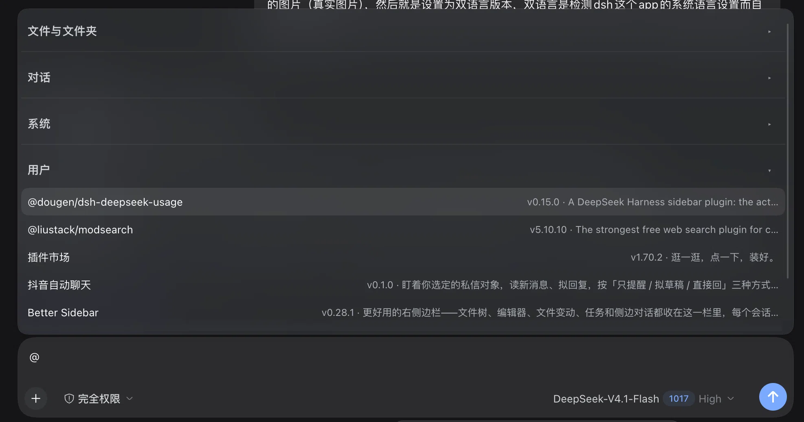

# dsh-at-plugins

**中文** ｜ [English](README.en.md)

> DeepSeek Harness 的 `@` 菜单增强：插件按「系统 / 用户」分组、会话按所在文件夹归类，分组标题吸顶、带计数、可折叠。

在输入框打 `@` 时，DSH 默认只给「文件」和「会话」。这个插件把**你装了哪些插件**也变成一类可 `@` 的候选，顺手把长列表切成看得清的小块。

<p align="center">
  
  
  
  <a href="https://github.com/thynon/dsh-at-plugins/actions/workflows/check.yml"></a>
</p>

## 截图

两张都是真机截图，同一个 `@` 菜单。

| 装之前 | 装之后 |
|---|---|
|  |  |
| 只有「文件与文件夹」和「对话」 | 多了「系统」「用户」两组插件；这张里「系统」组是折叠状态 |

装之后那张把「系统」组折起来了，正好能看到折叠后的效果。

> 两张图摄于 0.1.1。0.1.2 把标题做成吸顶、加了行数徽标，并用 CSS 伪元素画折叠箭头和计数；0.1.3 修掉了标题里的节点注入；0.1.4 用无匹配占位行阻止菜单自动关闭；0.1.5 加了查询防抖并移除了会触发原生 tooltip 的动态 title；0.1.6 锁定了菜单面板高度，过滤到一行时不再整块缩下去。视觉不变。

## 为什么

`@` 菜单是 DSH 里最快的一条指令通道，但它只认识文件和工作区里的会话。装上插件之后，「这个功能是哪个插件带来的」只能靠记忆去翻「设置 → 插件」。

于是：把插件清单接进 `@`，并且按来源分清楚——**系统**（随客户端发的）和**用户**（自己 `dsh plugin add` 装的）。长名单再加三个扶手：分组标题吸顶并显示行数、分组可折叠、会话按文件夹归类。

## 功能

### 插件：系统 / 用户

| 判据 | 归类 |
|---|---|
| `availability === 'installation'`（包在 DSH 安装目录的 `package.json` 里，随客户端发） | 系统 |
| `availability === 'profile'`（只出现在 profile `dependencies` 里，`dsh plugin add` 装的） | 用户 |

**不拿 `official` 当系统判据**：官方可选包被你装进 profile 后 `official` 仍是 `true`，但它不在安装目录里，对你来说就是「我装的」，所以归用户。

系统在前、用户在后；组内已启用在前，未启用的描述里带「未启用」。
随包发但**没启用**的系统插件不列——`@` 了也没有任何东西会响应。

数据来自宿主 `pluginManager.listBundles`，只读，不装、不卸、不改启停。

**没有匹配时也不会返回空列表**：查询不到插件时给一行「没有匹配的插件」，而不是 `[]`。DSH 的菜单规则是「所有来源都 ready 且为空就自动关闭」；输入法组合期间（比如打 `chajian` 还没上屏「插件」）会先出现一个匹配不到东西的中间查询，返回空会让整个菜单关掉、上屏后再打开——看起来就是菜单在开合。占位行不可选中，按 Esc 关闭。

连续打字时插件来源会等约 120ms 再按新查询过滤；这段时间菜单保留上一批候选，避免输入法组合/快速输入时每次按键都把菜单缩成一行再撑开。停手后才更新一次。

另外，菜单面板会在第一次展示候选时锁定高度（受当前可用空间限制）：即使过滤到只剩一行「没有匹配的插件」，面板也不会从几百像素缩成一个小弹窗，只会在面板内部换内容。

插件行本身也做了一点减法：

- 有 `meta.icon` 就显示插件自己的 14px 图标（只接受 `data:image/...;base64`），没有就退回内置的盒子图形
- 版本号和描述放在右侧副文本里；描述不再从第 42 个字符处硬切，交给 CSS 的省略号按实际宽度收尾
- 未启用的行在描述末尾标「未启用」，并排在组内末尾

### 会话：按所在文件夹分组

会话原来一律挂在「会话」标题下。现在按 `cwd` 的目录名分组：

```
default-workspace
  修 bug                 1h
  子会话                 3min · 子代理
Minecraft
  看盘                   现在
```

- 当前会话所在的文件夹排最前，其余按名字
- 同名文件夹（`~/work/src` 和 `~/play/src`）不会再被合并：当前文件夹保留短名 `src`，其他重名的逐级加上父目录，显示成 `play/src`
- 子代理会话留在它自己那个文件夹里，描述后面标「子代理」
- 本地查不到的会话（别的工作区、已经清掉的）退回原来的「会话」组排在最后，不塞进「其他文件夹」

### 分组标题：吸顶、计数、可折叠

- **吸顶**：列表滚动时当前分组标题停在菜单顶部，长列表里不会滚丢「我现在在哪一组」
- **计数**：标题右侧显示这一组有几行（1 行的组不显示，避免噪音）；折叠后仍然看得到被收起了多少项
- **折叠**：3 行以上标题右侧出现箭头和行数，点标题本身就能折叠；箭头和计数都用 CSS 伪元素画，不往 React 管理的标题节点里插子节点
- **不打断输入**：标题在 `mousedown` 阶段阻止默认行为，点它不会让输入框失焦；折叠是鼠标增强，菜单焦点始终留在输入框
- **只改 `@` 菜单**：通过 `[data-trigger-menu]` 加 option id 前缀识别，斜杠命令菜单、模型选择器之类的 listbox 一概不碰

标题字号 14px / 650，配吸顶背景和分隔线，跟 13px 的候选行拉开层次。折叠状态在窗口里一直保留。

### 插件引用是一枚原子 chip

选中插件后插进草稿的是一枚**原子引用**，跟文件／会话引用同一种节点，不是一行普通字符：

- 输入框里显示成 `@ 插件市场` 的胶囊，退格一次删整块
- 提交时由 `codec.serialize` 还原成模型形态
- 聊天记录里用 `conversation.user.text.node` 渲染成同款 chip

模型看到的是：

```
@[插件市场](dsh-plugin:dshmarket) 帮我把这个源列表刷新一下
```

宿主半端还会往系统提示词里加一段，告诉模型这种写法是什么意思：用户点名了某个插件，优先用它的能力。

## 安装

要求：DeepSeek Harness ≥ 0.2.1-rc.3、Node ≥ 22。

```bash
git clone git@github.com:thynon/dsh-at-plugins.git
cd dsh-at-plugins

# 1. 把包挂进 profile：写 dependencies + dsh.profile.bundles
node install.mjs ~/.dsh/profiles/desktop .

# 2. 建 node_modules 链接
cd ~/.dsh/profiles/desktop && pnpm install
```

然后**重启 DeepSeek Harness**（新 bundle 要重新组合 profile；之后只改 `client.js` 的话刷新页面就够）。

不放心脚本的话，手工改两处也一样：

```jsonc
// ~/.dsh/profiles/desktop/package.json
{
  "dsh": { "profile": { "bundles": [ /* … */, "dsh-at-plugins" ] } },
  "dependencies": {
    "dsh-at-plugins": "link:/绝对路径/dsh-at-plugins"
  }
}
```

## 卸载

把 `dsh-at-plugins` 从 `dsh.profile.bundles` 里删掉（依赖那行可以留着），重启即可。它没有改任何宿主数据，除了一枚挂在系统提示词上的段落，卸载即回收。

## 语言

- **插件界面**跟随 DSH 的语言设置（设置 → 常规），即时切换：字典 `zh` / `en` 各一份，走 `ctx.locale.register`。分组标题、折叠提示、空态提示都会跟着变。
- **README** 有中文和英文两份，GitHub 不支持按语言自动切换，只能在页首点过去。

## 实现要点

| 做的事 | 怎么做的 |
|---|---|
| 插件候选 | `inputTriggers.registerSource({ trigger: '@', ... })`，`meta.icon` 包成 14px 图片组件 |
| 会话分组 | 拦 `reference` 来源的 `candidates()`，按 `cwd` 分组（不是按显示名），只重写 `kind: 'session'` 行的 `section`，文件行原样透传 |
| 标题增强 | `MutationObserver` + `[data-trigger-menu]` 里 option id 前缀识别 `@` 菜单；只写 `data-dshatp-count` / `foldable` / `folded` 属性，箭头和计数用 `::before` / `::after` 画 |
| 吸顶 | 标题 `position:sticky` + `scroll-margin-top` 给 `scrollIntoView` 留出被标题盖住的高度 |
| 行内 chip | 原子 `insert` + `codec` + `conversation.user.text.node` 渲染器 |

几处踩过的坑，写在代码注释里：组名不能读 `textContent`（伪元素和额外节点会被算进去）；写相同值的 `data` 属性会再次触发 `MutationObserver`，容易自激；不要往 React 管理的标题节点里插子节点，也不要移动它的文本节点——React 重渲染时会删掉它们或 `removeChild` 失败，菜单就会在打字时闪烁；吸顶标题会盖住 `scrollIntoView` 的目标，必须配 `scroll-margin-top`。

## 边界与已知限制

- 只列**在跑的**包（`installed` 或 `enabled`）；没装的官方可选包、随包发但没启用的系统插件、以及 profile 里不是 bundle 的普通依赖都不列。
- 只读：不装、不卸、不改启停。要改去「设置 → 插件」。
- 查询无匹配时菜单不会自动关闭，而是显示「没有匹配的插件」；按 Esc 或删掉 `@` 关闭。
- 插件清单缓存 5 秒。
- 折叠是**视觉**折叠：被折起来的行仍在菜单数据里。方向键落到看不见的行时，插件会沿同一方向把高亮挪到最近的可见行（借菜单自己的 hover 通道）；回车／Tab 落在看不见的行上会被拦掉，不会误插。
- 折叠是标题点击（鼠标）增强；菜单焦点始终留在输入框，键盘用户可以用方向键跳过折叠组，但没法用键盘直接开合某一组。后续如果上游开放菜单数据层的过滤接口，可以改成真正的数据折叠。
- 会话分组依赖上游 `ui-reference` 的行结构（`value` 里的 `kind: 'session'`）与 `sessions.list` 的 `cwd`。上游改了，会退化成原样显示，不丢候选。
- 菜单增强靠 `[data-trigger-menu]`、`[role="listbox"]`、`[role="presentation"]` 和 `dsh-slash-option-<source>-` 这组结构识别 `@` 菜单，不依赖内部哈希类名；但菜单结构大改时仍可能失效——失效表现为「标题不吸顶/没有折叠箭头」，不影响 `@` 本身。
- 插件图标只认 `meta.icon` 里的 `data:image/...;base64`；格式不符或图片加载失败时退回内置图形。
- 会话文件夹重名超过三级父目录仍可能撞名（极少见），此时按最后显示名排序，不会丢行。

## 开发

```bash
node check.mjs
```

不开浏览器、不装 DSH，用一套极小的 React／DOM 替身把 `client.js` 和 `index.js` 真跑一遍：宿主提示词、插件来源与系统/用户判定、会话按文件夹归类与同名消歧、插件图标与长描述、空态/错误态/无匹配占位行、查询防抖、面板高度锁定、标题吸顶与计数、折叠点击回环、`@` 菜单识别不误伤斜杠菜单、`onPick` 的插入形态与 `codec`、chip 渲染。CI 在每次 push 时跑同一份。

## License

本项目**不是** OSI 认可的开源许可，而是「源码可见、非商业」许可：

- ✅ 可免费使用、修改、二次创作、再分发
- ✅ 衍生作品必须保留署名——**落在源代码文件里**至少一处，只在 README 写不算
- ❌ 未经书面许可，不得收费（包括衍生作品的任何收费形式）
- ❌ 衍生作品不得改成更宽松的许可（不能改回 MIT / Apache-2.0）

完整条款见 [LICENSE](LICENSE)。需要商业授权找 [@thynon](https://github.com/thynon)。
